<div align="center">




<br/>


</div>

---

## `> whoami`

```ts
const mubassir = {
  name: "Mubassir Ebne Mohsin",
  role: "Student & Backend Developer",
  currentlyLearning: ["NestJS", "TypeORM", "PostgreSQL"],
  tools: ["VS Code", "Postman", "DBeaver", "Git"],
  mission: "Build clean, reliable APIs backed by real databases.",
};
```

## `> ./skills`



<div align="center">


</div>

## `> ls projects/`

| Project | What it is |
|---|---|
| [**AWT_course-repo**](https://github.com/Mubassir-Ebne-Mohsin/AWT_course-repo) | Advanced Web Tech coursework, including a NestJS + PostgreSQL + TypeORM product and employee management API |
| [**process-order**](https://github.com/Mubassir-Ebne-Mohsin/process-order) | JavaScript order processing example |

## `> stats`

<div align="center">


</div>


